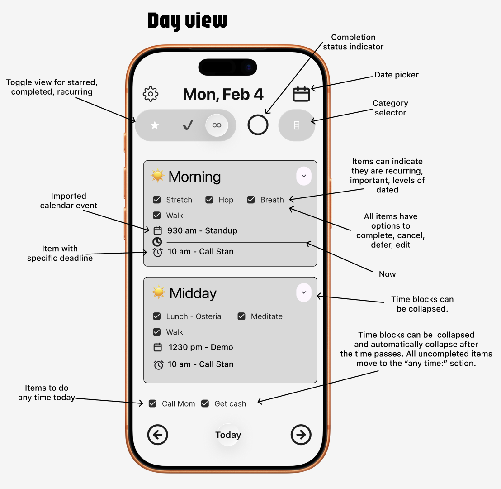
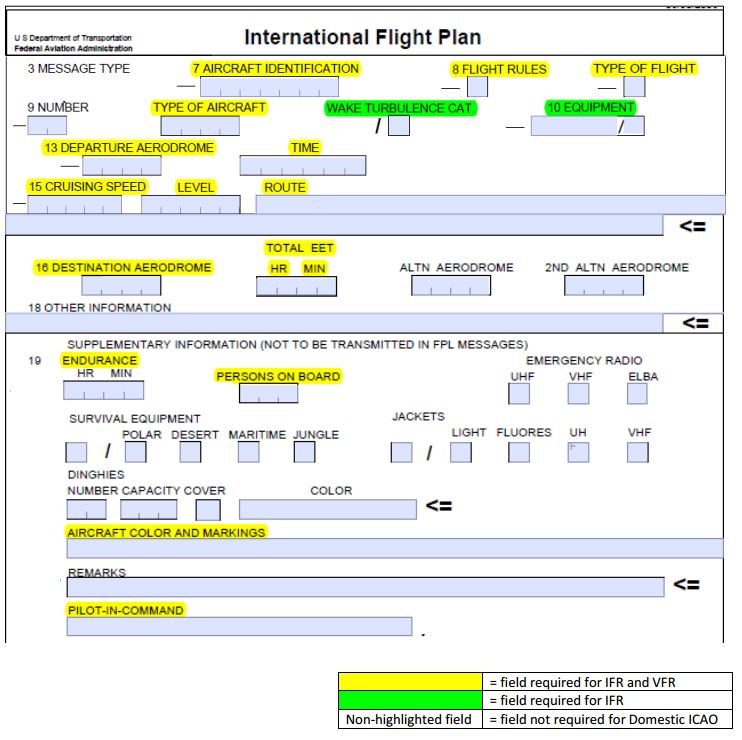
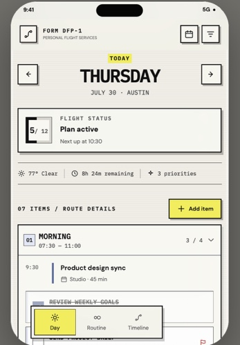
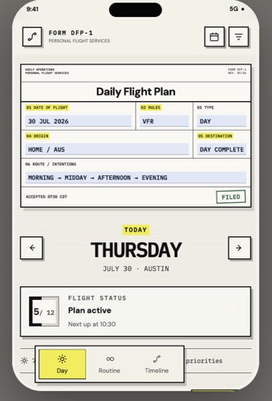
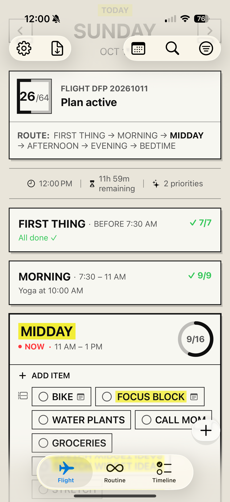
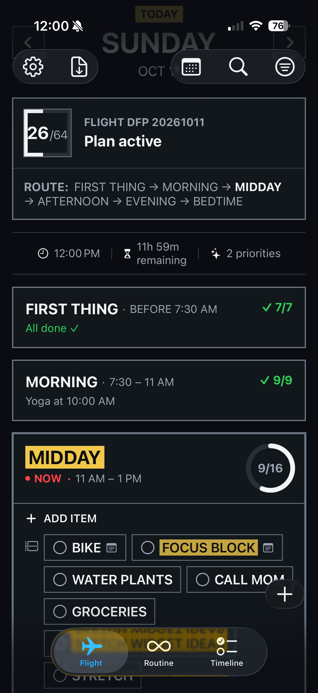

# Daily Flight Plan: the full story

This project is a small case study in taking an idea from a napkin to a working app, as the product owner, the designer and the developer, with an AI agent as a collaborator.

**1. The problem: lists that outgrew me.** For years I tried planner and to-do apps, looking for a way to get the most out of busy days. They all went the same way. Lists accumulated until some days had 50 to 70 items, which was demotivating, and I couldn't keep up. And many of those items were routines, like morning stretches, that never meshed with my real to-do lists.

**2. The workaround: a Day One template called "Daily Flight Plan".** My real solution was a daily journaling template in Day One, and I named it Daily Flight Plan. It listed all my recurring daily items, organized by part of the day (first thing, morning, midday and so on), and I added new items right into it. I honed that routine and approach for a long time. It helped, but even as a journal document it got too large and messy, and it still wasn't quite right. This app is the better version of that template.

**3. The first shot: a feature spec and a back-of-napkin sketch.** I wrote down the features I wanted and sketched a first-shot UI in Figma, the digital equivalent of a napkin drawing, with no AI involved. The spec kept what worked in my template, the parts of the day, and added the things the template couldn't do: calendar events inline, deadline items, recurring items, filters and a progress indicator. The sketch annotated the behavior: collapsible time blocks, a "now" bar, and an "any time" area where unfinished items fall. The goal was an app that continually narrows and focuses on what you need to know right now. I also set technical constraints: reuse the architecture from my other app, [Map Plus](https://github.com/patmcgtx/mapplus), use SwiftData, and generate mock services and previews as we go.

 
<b>The first shot</b> &middot; My annotated Figma sketch

**4. Going AI-forward: the plan, then the build.** For the coding I made a deliberate decision to work AI-forward. I handed the spec to a Claude agent to propose an architecture and a phased implementation plan, and it became the living plan the whole build followed. Then we built it in small phases, more than twenty, each one tested by actually using it, and I kept changing my mind as I did. Along the way I:
- tried several alternative views (Cards, Nav Log, a grid), keeping only what earned its place
- added features the mock never had: a dedicated Routine tab for managing recurring habits as a set (the mock and spec already had recurring items, but not this management layer), iCloud sync, Mac support, and a paste-to-import flow powered by on-device Apple Foundation Models
- **removed** a chat-style quick-entry tab I'd built, because it was buggy and the import flow already did its job better
- built each answer to the original problem into the app: **no automatic carry-forward** (unfinished items stay on their original date unless I move them, so a day never inherits a backlog), a separate **Routine** layer so habits like morning stretches live alongside my to-dos without cluttering them, and progress shown as how far you've come. I may add an opt-in way to pull items forward later, so it becomes a choice instead of a default.

**5. The flight plan: a visual style with a point of view.** While using the app, I kept looking for a more well-defined visual style, and the real thing was right there: the FAA flight plan, a dense, structured, no-nonsense form that pilots fill out before they go anywhere. I took another pass in Figma, this time with its AI "Make" feature, to explore it, then redesigned the main screen as a filed paper flight plan: monospaced type, flat black borders with hard shadows, a yellow highlighter for what matters, and a dark "Paper Night" mode. It started as a design experiment and was good enough to replace the main view.

 
<b>The visual inspiration</b> &middot; An FAA flight plan form

&nbsp;&nbsp;
 
<b>Figma Make exploration</b> &middot; Refined in the app

&nbsp;&nbsp;
 
<b>Final product</b> &middot; The Flight view in light mode and "Paper Night"

**What stayed from the mock:** time-of-day sections, the "now" marker, inline calendar events, recurring and flagged items, a progress indicator, and the "today is a trip" idea. **What changed:** nearly everything about how it looks and feels, and a lot of what it can do.

Read the paper trail:
- [`docs/project-spec-prompt.md`](project-spec-prompt.md): the original feature and UX spec
- [`docs/architecture.md`](architecture.md): folder structure, data models, services, UI direction
- [`docs/implementation-plan.md`](implementation-plan.md): the phased plan and progress
