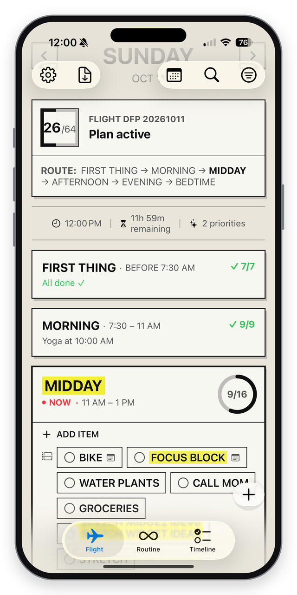
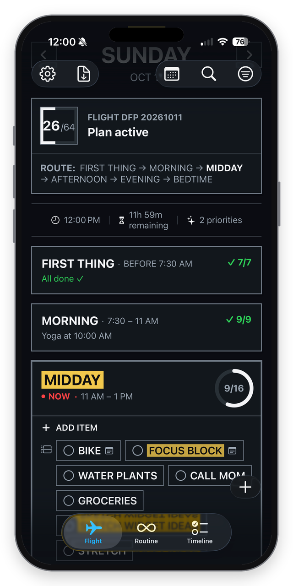

# Daily Flight Plan

A daily planning and execution app for iOS, inspired by an airplane flight plan checklist. Today is your trip; this is your checklist.

> “Finish every day and be done with it!”
> — Ralph Waldo Emerson

See this app's [plan and progress](DailyFlightPlan/docs/implementation-plan.md).

<p align="center">
  
  &nbsp;&nbsp;
  
</p>

## Goals

Most people already know how to plan their day. The hard part is actually executing it — staying aware of what you committed to, not losing track of things as time passes, and finishing with a real sense of completion rather than just motion.

Daily Flight Plan is about execution, not planning. It's a lightweight layer on top of your existing Calendar and Reminders — not a replacement — that gives your day clear structure and focuses your attention on what matters right now.

**Design principles:**
- **One day at a time.** The app lives in today. Past and future are reference, not focus.
- **Present, not just planned.** The goal isn't just to have a list — it's to stay aware and present as the day unfolds.
- **Fast and out of your way.** Checking off and adding items should take seconds, not decisions.
- **Calm, not urgent.** Time-of-day sections create structure without adding pressure.
- **Context on your terms.** Calendar events and Reminders appear inline for full context, but can be toggled off instantly when you need to narrow your focus to just your own plan.
- **Finishing feels good.** Progress is always visible; completing your plan feels like landing the plane.

**Version 1.0 target:** A polished, public-release app with full fit/finish, accessibility, and beta testing complete. The 0.x series builds toward it: core functionality (0.1), UX polish (0.2), settings + device expansion (0.3), and in-app purchases (0.4). Watch and Siri come later (Version 3.0).

## From idea to app

I turned a Day One routine I'd refined for years into a native iOS app: a Figma sketch, an AI-assisted build with a Claude agent, and a redesign inspired by the FAA flight plan. Here's the path.

<table>
<tr>
<td align="center" valign="bottom" width="50%"></td>
<td align="center" valign="bottom" width="50%"></td>
</tr>
<tr>
<td align="center" valign="top" width="50%"><sub><b>Concept</b><br>First-shot sketch, in Figma</sub></td>
<td align="center" valign="top" width="50%"><sub><b>Concept</b><br>Visual inspiration: an FAA flight plan form</sub></td>
</tr>
</table>

<table>
<tr>
<td align="center" valign="bottom" width="50%"></td>
<td align="center" valign="bottom" width="50%"></td>
</tr>
<tr>
<td align="center" valign="top" width="50%"><sub><b>Final product</b><br>Flight view, light</sub></td>
<td align="center" valign="top" width="50%"><sub><b>Final product</b><br>Flight view, "Paper Night"</sub></td>
</tr>
</table>

**1. The problem.** Years of planner apps, and lists that ballooned to 50 to 70 items a day. It was demotivating, and my routines never meshed with my real to-dos.

**2. The workaround.** A Day One template I also called "Daily Flight Plan", organized by part of the day. I refined it for years, but even as a journal document it got too large and messy. The app is the better version.

**3. The first shot.** A feature spec and a back-of-napkin sketch in Figma, with no AI, built around one goal: continually narrow to what you need to know right now.

**4. Going AI-forward.** I chose to build with AI. A Claude agent proposed the architecture and a phased plan, and we built it in twenty-plus phases. The product calls stayed mine: no automatic carry-forward by design, so a day never inherits a backlog, a separate Routine layer, and cutting a buggy chat tab.

**5. The flight plan.** Looking for a stronger visual style, I found it in the real FAA flight plan. After another Figma pass with its AI "Make" feature, I redesigned the main screen as a filed paper plan: monospaced type, hard borders, a yellow highlighter and a dark "Paper Night" mode.

**[Read the full story](DailyFlightPlan/docs/story.md)**, or browse the paper trail: the [original spec](DailyFlightPlan/docs/project-spec-prompt.md), [architecture](DailyFlightPlan/docs/architecture.md) and [implementation plan](DailyFlightPlan/docs/implementation-plan.md).

## Concept

Combines one-off and recurring tasks, organized into five time-of-day sections (Morning, Midday, Afternoon, Evening, Night). Items with specific deadlines appear as timed rows; items assigned to a section appear in a horizontal flow; items with no time at all land in an "Open" area at the bottom. A "now" bar tracks your current position in the day. Calendar events and Reminders from the system appear inline alongside your own tasks. All five sections are always visible — past sections stay on screen as a day-at-a-glance reference. Inactive sections auto-collapse with a one-line AI summary; items past a specific deadline surface in a "Missed" area. Navigate to a future date to see a ghosted preview of your expected recurring habits.

## Tech stack

- **SwiftUI + Liquid Glass** — primary UI framework with iOS 26 glass effects
- **SwiftData + CloudKit** — persistence with iCloud sync through a private CloudKit database
- **EventKit** — Calendar and Reminders integration
- **SwiftUI-Flow** (`HFlow`) — horizontal wrapping flow layouts for item pills
- **IBM Plex Mono** — bundled custom font for the Flight tab's filed-flight-plan paper aesthetic
- **`@Observable @MainActor` ViewModels** — no Combine
- **Protocol-based services** injected via `@Environment` + `@Entry`

## Features (current)

**Three tabs:**

- **Flight** — primary day view, styled like a filed paper flight plan (monospaced type, flat
  black borders, hard offset shadows, cream background; adapts to a dark "Paper Night" palette)
  - Day navigation via `←`/`→` buttons flanking the date heading (not swipe — a single `ScrollView`
    is used instead of a paging `TabView` so Liquid Glass bar transparency/blur tracks correctly)
  - "Today" label on a yellow highlighter badge; flagged items get the same highlighter treatment
    behind their title instead of a flag icon
  - Flight Status card: square `completed/total` progress indicator, status line, mock flight
    number (`DFP` + date), "Next up at HH:MM", and a Route/Intentions line listing all six day
    sections, bolding each once fully complete
  - Briefing row: live clock, live countdown to midnight, and outstanding-flagged-item count
  - Collapsible section cards with per-section progress ring (`completed/total`, filter-independent)
  - `HFlow` pills for non-deadline items (regular items and routine items on separate rows); timed rows for deadline items
  - Notes indicator icon on pills when notes are populated
  - Calendar events and Reminders shown inline in expanded section cards
  - Drag-and-drop items between section cards; drop on Open card to clear section assignment
  - Filter-driven expand/collapse: active filters auto-expand sections with matches
  - The original "Day" tab (`FlightPlanView`, swipe-pager-based) is retired in favor of this view —
    commented out, not deleted, in `DayView.swift` in case it's worth reviving

- **Routine** — recurring habit template management
  - Collapsible cards grouped by weekday pattern: Every Day, Weekdays, Weekends, plus any custom patterns (e.g. Mon/Wed/Fri)
  - Tap a card header to expand/collapse; collapsed state shows section name and item count
  - Each card subdivided by day segment (First Thing, Morning, …); each segment is its own collapsible card matching the Day view's look — tap to expand/collapse, title enlarges when expanded, `+ Add item` button pre-filled with that weekday pattern and segment
  - Timed items get their own row, untimed items flow as `HFlow` pills
  - Collapsed segments show a one-line AI-generated summary of their routines (falls back to a plain title/time preview when Apple Intelligence is unavailable, e.g. in Simulator)
  - Tap any item to edit; long-press for Edit / Delete context menu
  - Drag items between cards to reassign their weekday pattern
  - Add custom sections via a weekday picker; delete sections (severs templates from historical instances)

- **Timeline** — chronological multi-day list
  - Shows one-off and already-materialized plan items across all dates, lazily loaded 7 days at a
    time in each direction, with a filter bar and dedicated search; future dates show only
    one-off scheduled items, not projected recurring habits (those remain a Flight tab preview,
    since a routine could still change before the date arrives)
  - Fully interactive: checkbox completes, tap to edit, long-press for cancel

**macOS keyboard shortcuts:** `Cmd+1` Flight · `Cmd+2` Routine · `Cmd+3` Timeline

**Shared across tabs:**
- Add and edit items via a full-featured form (title, notes, flag, deadline, section, recurring days, categories)
- Long-press any item for a context menu: cancel, defer to tomorrow, edit
- Recurring habit templates with weekday picker; per-day instances materialized lazily
- Deadline-based items with clock-time rows; missed deadlines surface in a "Missed" area
- Filter menu: flagged, done, calendar, reminders, routines, and category filters
- **Markdown / text import**: paste any text (e.g. a Things export) → Foundation Models parses titles, sections, and recurring schedules → review list with swipe-to-delete → commit or cancel
- **Markdown export**: a toolbar button on the Flight and Routine tabs renders items as Markdown (title, flagged/completion status, categories, notes, plus day-section grouping and — on Routine — schedule grouping) in a sheet with a Preview/Raw toggle, one-tap Copy, and a `ShareLink` (AirDrop, Messages, Save to Files, etc.)
- Category management (add, rename, delete)
- Theme switcher (Cupertino, 8-Bit, Kerby, Flamingo) — currently dormant: its toolbar menu lived
  only on the now-retired Day tab; `DFPTheme`/`ThemeViewModifier` are still wired up for when a
  switcher is reintroduced somewhere
- Calendar events from EventKit shown inline, with calendar color indicator
- Reminders from EventKit shown inline, with list color indicator; live-updates on store changes
- **Fresh start each day**: no automatic carry-forward — pending items stay on their original date unless you move them yourself; a dedicated missed-items review flow is planned (see Phase 2.7)
- **Future date preview**: recurring habits for a future weekday appear ghosted in their section
- iCloud sync via CloudKit (plan on Mac, execute on iPhone)

## Project structure

```
DailyFlightPlan/
├── Common/              — App entry point, Environment.swift, service injection
├── Persistence/         — SwiftData models (PlanItem, PlanCategory, DaySection, ItemStatus)
├── Preferences/         — AppStorageKeys enum
├── Services/
│   ├── Calendar/        — CalendarService protocol + EventKit + mock
│   ├── Reminders/       — RemindersService protocol + EventKit + mock
│   └── Categories/      — CategorySelectionService
├── Theming/
│   ├── DFPTheme.swift        — theme enum + ThemeViewModifier (dormant — see Theme switcher note above)
│   ├── PaperPlanStyle.swift  — color/font tokens for the Flight tab's paper look
│   └── Fonts/                — bundled IBM Plex Mono (.ttf), registered via Info.plist UIAppFonts
└── Views/
    ├── Components/      — DaySectionView, ItemPillView, DeadlineItemRow, CalendarEventRow,
    │                      ReminderItemRow, NowBarView, ProgressRingView, CategoryCapsule
    ├── View Models/     — DayViewModel, ItemFormViewModel, CategoriesEditViewModel
    ├── DayView.swift          — TabView host; manages shared state, fetches calendar/reminders
    ├── PaperPlanView.swift    — Flight tab (primary day view, paper-plan styling)
    ├── FlightPlanView.swift   — retired Day tab (swipe pager); commented out in DayView, kept for reference
    ├── RoutineView.swift      — Routine tab (recurring habit template management)
    ├── RoutineMarkdownExporter.swift — Pure Markdown rendering for the Routine tab's export
    ├── DayPlanMarkdownExporter.swift — Pure Markdown rendering for the Flight tab's export
    ├── MarkdownExportView.swift — Shared export sheet (Preview/Raw toggle, Copy, ShareLink)
    ├── MarkdownImportView.swift — Paste-to-import sheet; Foundation Models structured parsing
    ├── CardDeckView.swift     — Cards tab (commented out)
    ├── TimelineView.swift     — Timeline tab
    ├── ItemForm.swift
    └── CategoriesEditView.swift
```

## Build plan

Version 0.1 (Phases 1.1–1.22) is feature-complete — core functionality is working but not yet polished for public release.

**Version 0.2** improves existing views:

| Phase | Description |
|-------|-------------|
| 2.1 | ✅ Routine view refinements |
| 2.2 | ✅ Remove Comm tab (too buggy, superseded by Markdown Import) |
| 2.3 | ✅ Global filter sheet + category management |
| 2.4 | ✅ Paper Plan view — replaces Day tab as the primary view |
| 2.5 | Day/Flight view refinements |
| 2.6 | Import UX refinements (flag duplicates, notes, tagging) |
| 2.7 | Missed items review & pull-forward |
| 2.8 | Nav Log / Timeline refinements + paper treatment |
| 2.9 | Routine refinements + paper treatment |

**Version 0.3** expands device support and adds missing features:

| Phase | Description |
|-------|-------------|
| 3.1 | Settings (calendar/reminders selection, section boundaries) |
| 3.2 | Local notifications |
| 3.3 | Rich item content (web links, photo attachments) |
| 3.4 | iPad support (adaptive layout, Stage Manager, keyboard nav) |
| 3.5 | Sharing & export (Markdown export shipped ahead of schedule; share scope/format still open) |
| 3.6 | Projects support (spike — does this replace or complement categories?) |

**Version 0.4** adds monetization:

| Phase | Description |
|-------|-------------|
| — | In-app purchases (StoreKit 2, Pro Themes, Unlimited Categories) |

**Version 1.0** is the public release target:

| Phase | Description |
|-------|-------------|
| release.1 | Full-app UX audit |
| release.2 | Fit and finish + aviation UI spike |
| release.3 | Performance & stability audit (incl. smooth day swipe navigation) |
| release.4 | Tech debt (unit tests, UI tests, architecture review) |
| release.5 | Beta testing |

See [`docs/implementation-plan.md`](DailyFlightPlan/docs/implementation-plan.md) for full details including Version 3.0 plans (Siri, Widgets, Apple Watch).

## Building

Open `DailyFlightPlan/DailyFlightPlan.xcodeproj` in Xcode 26+, select a simulator or device, and run. No additional setup required — SwiftUI-Flow is fetched via Swift Package Manager.
