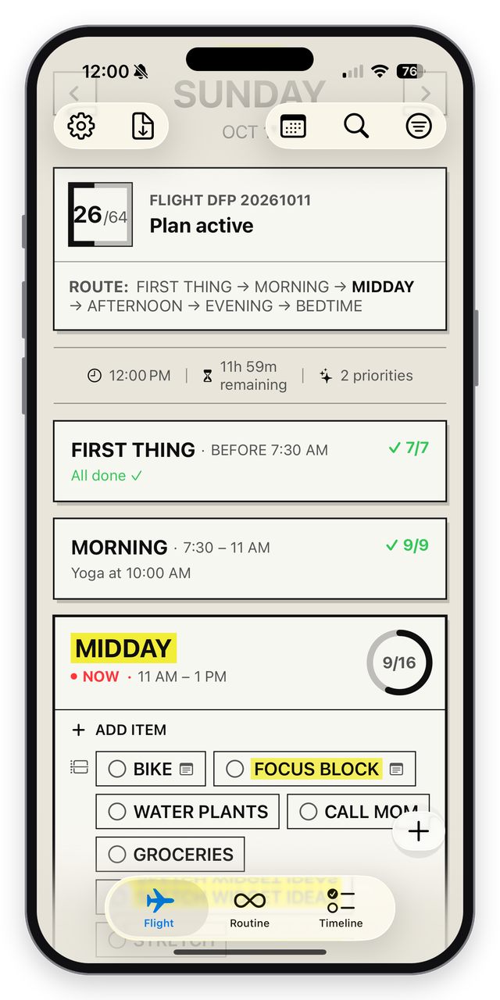
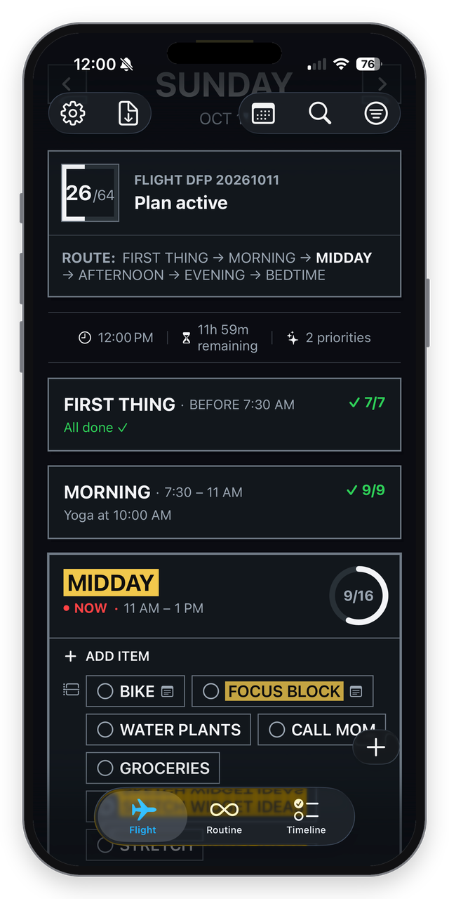
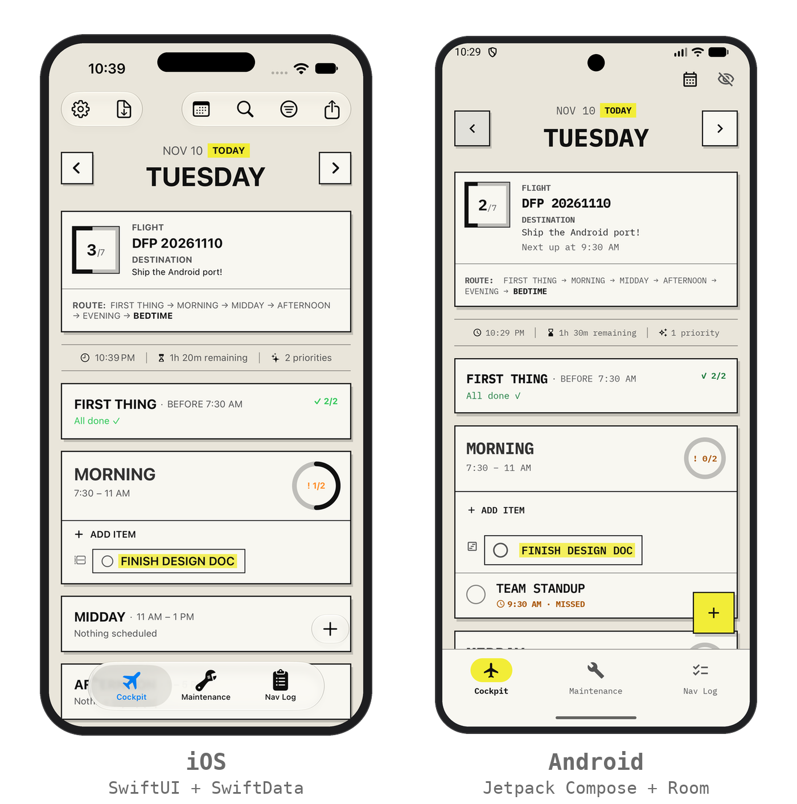
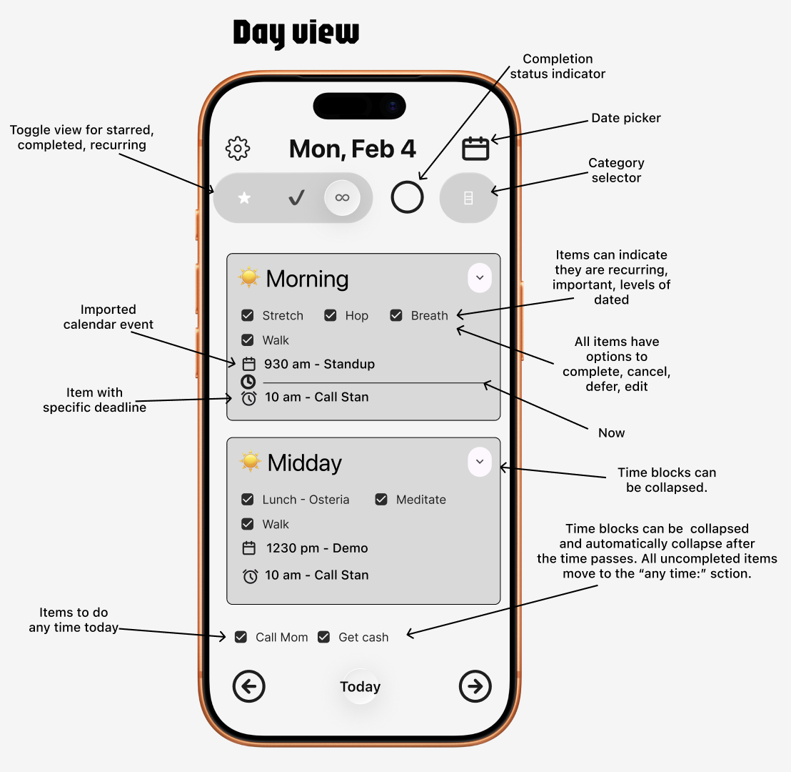
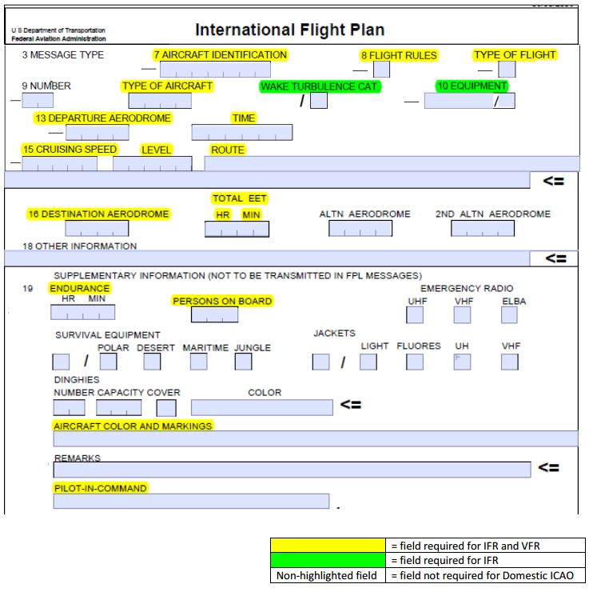
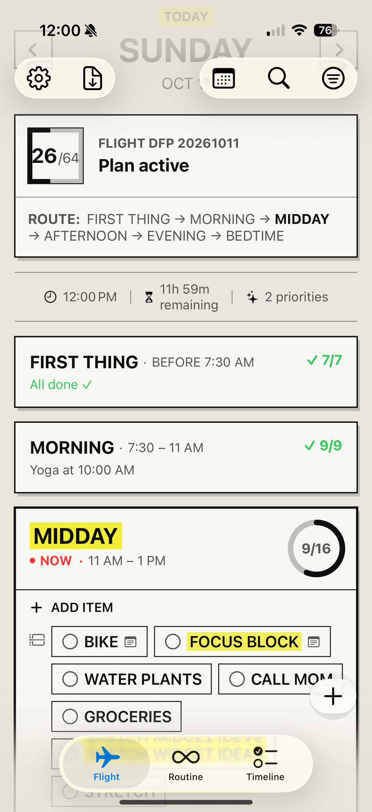
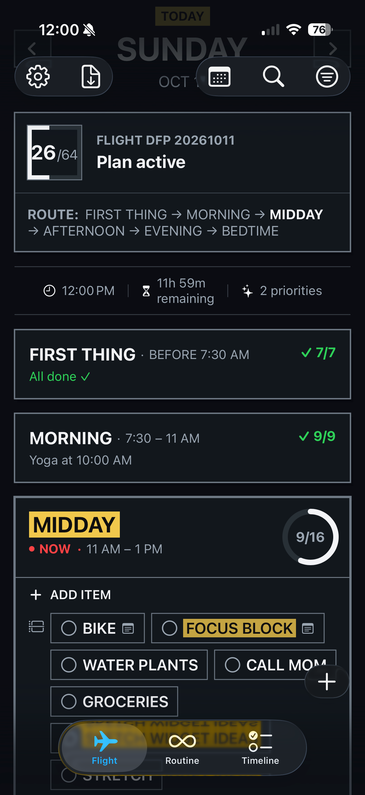

# Daily Flight Plan

A daily planning and execution app for iOS, with an early native Android port, inspired by an airplane flight plan checklist. Today is your trip; this is your checklist.

> “Finish every day and be done with it!”
> — Ralph Waldo Emerson

See this app's [plan and progress](DailyFlightPlan/docs/implementation-plan.md).

<p align="center">
  
  &nbsp;&nbsp;
  
</p>

## Now on Android

An early native Android port (Kotlin, Jetpack Compose, Room) lives in [`android/`](android/README.md): the same design and layering, built from this app's design docs and tests. v1 is deliberately small: the Cockpit tab with local storage, plus accessibility work (measured color contrast, screen-reader support, large fonts). Sync, routines, calendar and AI are out for now.

<p align="center">
  
</p>

## Goals

Most people already know how to plan their day. The hard part is actually executing it — staying aware of what you committed to, not losing track of things as time passes, and finishing with a real sense of completion rather than just motion.

Daily Flight Plan is about execution, not planning. It's a lightweight layer on top of your existing Calendar and Reminders — not a replacement — that gives your day clear structure and focuses your attention on what matters right now.

**Design principles:**
- **One day at a time.** The app lives in today. Past and future are reference, not focus.
- **Present, not just planned.** The goal isn't just to have a list — it's to stay aware and present as the day unfolds.
- **Fast and out of your way.** Checking off and adding items should take seconds, not decisions.
- **Calm, not urgent.** Time-of-day sections create structure without adding pressure.
- **Context on your terms.** Calendar events and Reminders appear inline for full context, but can be toggled off instantly when you need to narrow your focus to just your own plan.
- **Finishing feels good.** Progress is always visible; completing your plan feels like landing the plane.

**Version 1.0 target:** Core features complete, with full fit/finish, accessibility, and beta testing done. The 0.x series builds toward it: core functionality (0.1), UX polish (0.2), and settings + device expansion (0.3). Watch, Siri, widgets, and an in-app purchases proof of concept come later (Future Plans).

## From idea to app

I turned a Day One routine I'd refined for years into a native iOS app: a Figma sketch, an AI-assisted build with a Claude agent, and a redesign inspired by the FAA flight plan. Here's the path.

<table>
<tr>
<td align="center" valign="bottom" width="50%"></td>
<td align="center" valign="bottom" width="50%"></td>
</tr>
<tr>
<td align="center" valign="top" width="50%"><sub><b>Concept</b><br>First-shot sketch, in Figma</sub></td>
<td align="center" valign="top" width="50%"><sub><b>Concept</b><br>Visual inspiration: an FAA flight plan form</sub></td>
</tr>
</table>

<table>
<tr>
<td align="center" valign="bottom" width="50%"></td>
<td align="center" valign="bottom" width="50%"></td>
</tr>
<tr>
<td align="center" valign="top" width="50%"><sub><b>Final product</b><br>Flight view, light</sub></td>
<td align="center" valign="top" width="50%"><sub><b>Final product</b><br>Flight view, "Paper Night"</sub></td>
</tr>
</table>

**1. The problem.** Years of planner apps, and lists that ballooned to 50 to 70 items a day. It was demotivating, and my routines never meshed with my real to-dos.

**2. The workaround.** A Day One template I also called "Daily Flight Plan", organized by part of the day. I refined it for years, but even as a journal document it got too large and messy. The app is the better version.

**3. The first shot.** A feature spec and a back-of-napkin sketch in Figma, with no AI, built around one goal: continually narrow to what you need to know right now.

**4. Going AI-forward.** I chose to build with AI. A Claude agent proposed the architecture and a phased plan, and we built it in twenty-plus phases. The product calls stayed mine: no automatic carry-forward by design, so a day never inherits a backlog, a separate Routine layer, and cutting a buggy chat tab.

**5. The flight plan.** Looking for a stronger visual style, I found it in the real FAA flight plan. After another Figma pass with its AI "Make" feature, I redesigned the main screen as a filed paper plan: monospaced type, hard borders, a yellow highlighter and a dark "Paper Night" mode.

**6. The Android port.** To see how well the architecture travels, I ported a small v1 to Kotlin and Jetpack Compose in six phases, using this app's docs and tests as the spec: scaffold and theme, pure logic with tests, a Room layer, the Cockpit UI, the item form, and a polish pass. The iOS test suites became the specs for the Android ones (JUnit 5). I chose a native port over Kotlin Multiplatform, Flutter, or React Native because the iOS app stays SwiftUI and SwiftData. Along the way I measured color contrast instead of assuming it, and fixed three light-mode status colors that failed WCAG. See [`android/`](android/README.md) and the [port plan](android/docs/android-port-plan.md).

**[Read the full story](DailyFlightPlan/docs/story.md)**, or browse the paper trail: the [original spec](DailyFlightPlan/docs/project-spec-prompt.md), [architecture](DailyFlightPlan/docs/architecture.md) and [implementation plan](DailyFlightPlan/docs/implementation-plan.md).

## Concept

Combines one-off and recurring tasks, organized into six time-of-day segments (First Thing, Morning, Midday, Afternoon, Evening, Bedtime). The Cockpit puts time-specific commitments first: an **Up Next** list gathers every timed Calendar event, Reminder and deadline item, with a countdown on the next one, while all-day events get their own card above it. Items whose moment has gone (a missed deadline, or an untimed item in a segment that has ended) move into a quiet **Passed** area, where you can move them to now or cancel them in bulk. Everything else stays in its segment: items assigned to a segment appear in a horizontal flow, routine ("Maintenance") items get their own row, and items with no time at all land in an "Open" area at the bottom. A "now" bar tracks your current position in the day. Past days become a read-only **Flight Report**, and future days show a "Scheduled" list of what's already timed.

## Tech stack

- **SwiftUI + Liquid Glass** — primary UI framework with iOS 26 glass effects
- **SwiftData + CloudKit** — persistence with iCloud sync through a private CloudKit database
- **EventKit** — Calendar and Reminders integration
- **SwiftUI-Flow** (`HFlow`) — horizontal wrapping flow layouts for item pills
- **IBM Plex Mono** — bundled custom font for the Cockpit tab's filed-flight-plan paper aesthetic
- **`@Observable @MainActor` ViewModels** — no Combine
- **Protocol-based services** injected via `@Environment` + `@Entry`
- **Android port (early)** — Kotlin, Jetpack Compose, Room, `ViewModel` with `StateFlow`, JUnit 5 (see [`android/`](android/README.md))

## Features (current)

**Three tabs:**

- **Cockpit** — primary day view, styled like a filed paper flight plan (monospaced type, flat
  black borders, hard offset shadows, cream background; adapts to a dark "Paper Night" palette)
  - Day navigation via `←`/`→` buttons flanking the date heading (not swipe — a single `ScrollView`
    is used instead of a paging `TabView` so Liquid Glass bar transparency/blur tracks correctly);
    tap the date heading to jump to any date
  - "Today" label on a yellow highlighter badge; flagged items get the same highlighter treatment
    behind their title instead of a flag icon
  - Flight Status card: square `completed/total` progress indicator, tap-to-edit flight name
    (defaults to `DFP` + date), an editable "Destination" note for the day's intention (both
    persisted and synced), "Next up at HH:MM", and a Route/Intentions line listing all six day
    segments, bolding each once fully complete
  - Briefing row: live clock, live countdown to midnight, and outstanding-flagged-item count
  - **All Day** card: all-day Calendar events, collapsible
  - **Up Next**: every timed entry that isn't over — Calendar events, timed Reminders, and deadline
    plan items — in one list sorted by time; the next one gets a highlighter bar and a countdown.
    Plan items and Reminders stay completable from the list. On future days it's titled
    "Scheduled"
  - **Passed** (today only): open items whose moment has gone, oldest first, with an AI summary
    when collapsed; "Move to Now" per item, plus "Move all to now" and "Cancel all"
  - Collapsible segment cards with per-segment progress ring (`completed/total`, excluding items
    shown in Up Next or Passed); regular items and routine ("Maintenance", wrench icon) items
    flow in separate rows
  - Notes indicator icon on pills when notes are populated
  - Drag-and-drop items between segment cards; drop on the Open card to clear segment assignment
  - Past days show a read-only **Flight Report** instead: Completed, Missed and Canceled items,
    with no Add button, NOW marker, Calendar events or Reminders
  - Toolbar: a leading "More" menu (Search, Developer settings, Import, Export); trailing a View
    Options menu (Flagged Only, Completed, Maintenance, Calendar Events, Reminders, Empty Segments,
    UPPERCASE) and a Categories button. Pull the page down (or press Cmd+F) to reveal search
  - The original "Day" tab (`FlightPlanView`, swipe-pager-based) is retired in favor of this view —
    commented out, not deleted, in `DayView.swift` in case it's worth reviving

- **Maintenance** — recurring habit template management
  - Collapsible cards grouped by weekday pattern: Every Day, Weekdays, Weekends, plus any custom
    patterns (e.g. Mon/Wed/Fri)
  - Tap a card header to expand/collapse; collapsed state shows the pattern name and item count
  - Each card subdivided by day segment (First Thing, Morning, …); each segment is its own
    collapsible card — tap to expand/collapse, title enlarges when expanded, `+ Add item` button
    pre-filled with that weekday pattern and segment
  - Timed items get their own row, untimed items flow as `HFlow` pills
  - Collapsed segments show a one-line AI-generated summary of their routines (falls back to a
    plain title/time preview when Apple Intelligence is unavailable, e.g. in Simulator)
  - Tap any item to edit; long-press for Edit / Delete context menu
  - Drag items between cards to reassign their weekday pattern
  - Add custom weekday patterns via a weekday picker; delete them (severs templates from
    historical instances)

- **Nav Log** — chronological multi-day list
  - Shows one-off and already-materialized plan items across all dates, lazily loaded 7 days at a
    time in each direction, with a filter bar and dedicated search; future dates show only
    one-off scheduled items, not projected recurring habits (a routine could still change before
    the date arrives)
  - Fully interactive: checkbox completes, tap to edit, long-press for cancel

**macOS keyboard shortcuts:** `Cmd+1` Cockpit · `Cmd+2` Maintenance · `Cmd+3` Nav Log

**Shared across tabs:**
- Add and edit items via a full-featured form (title, notes, flag, deadline, section, recurring days, categories)
- Long-press any item for a context menu: cancel, defer to tomorrow, edit
- Recurring habit templates with weekday picker; per-day instances materialized lazily
- Deadline-based items appear in Up Next; once a deadline passes, a still-open item moves to Passed
- Filtering: a View Options menu (flagged, completed, maintenance, calendar, reminders) and a separate category picker on the Cockpit; a filter sheet on Maintenance and Nav Log
- **Markdown / text import**: paste any text (e.g. a Things export) → Foundation Models parses titles, sections, and recurring schedules → review list with swipe-to-delete → commit or cancel
- **Markdown export**: a toolbar action on the Cockpit and Maintenance tabs renders items as Markdown (title, flagged/completion status, categories, notes, plus day-segment grouping and — on Maintenance — schedule grouping) in a sheet with a Preview/Raw toggle, one-tap Copy, and a `ShareLink` (AirDrop, Messages, Save to Files, etc.)
- Category management (add, rename, delete)
- Theme switcher (Cupertino, 8-Bit, Kerby, Flamingo) — currently dormant: its toolbar menu lived
  only on the now-retired Day tab; `DFPTheme`/`ThemeViewModifier` are still wired up for when a
  switcher is reintroduced somewhere
- Calendar events from EventKit shown inline, with calendar color indicator
- Reminders from EventKit shown inline, with list color indicator; live-updates on store changes
- **Fresh start each day**: no automatic carry-forward — pending items stay on their original date unless you move them yourself; a dedicated missed-items review flow is planned (see Phase 0.2.9)
- **Future days**: the Cockpit lists what's already scheduled (timed items, Calendar events and Reminders); recurring habits are materialized only for today
- iCloud sync via CloudKit (plan on Mac, execute on iPhone)

## Project structure

```
DailyFlightPlan/
├── Common/              — App entry point, Environment.swift, service injection
├── Persistence/         — SwiftData models (PlanItem, PlanCategory, Day, DaySection, ItemStatus)
├── Preferences/         — AppStorageKeys enum
├── Services/
│   ├── Calendar/        — CalendarService protocol + EventKit + mock
│   ├── Reminders/       — RemindersService protocol + EventKit + mock
│   └── Categories/      — CategorySelectionService
├── Theming/
│   ├── DFPTheme.swift        — theme enum + ThemeViewModifier (dormant — see Theme switcher note above)
│   ├── CockpitStyle.swift  — color/font tokens for the Cockpit tab's paper look
│   └── Fonts/                — bundled IBM Plex Mono (.ttf), registered via Info.plist UIAppFonts
└── Views/
    ├── Components/      — DaySectionView, ItemPillView, DeadlineItemRow, CalendarEventRow,
    │                      ReminderItemRow, NowBarView, ProgressRingView, CategoryCapsule,
    │                      CockpitViewMenu, CategoriesToolbarButton, DatePickerButton,
    │                      InlineSearchBar
    ├── View Models/     — DayViewModel (+Agenda: Up Next / Passed / Flight Report),
    │                      ItemFormViewModel, CategoriesEditViewModel
    ├── DayView.swift          — TabView host; manages shared state, fetches calendar/reminders
    ├── CockpitView.swift    — Cockpit tab (primary day view, paper-plan styling)
    ├── FlightPlanView.swift   — retired Day tab (swipe pager); commented out in DayView, kept for reference
    ├── RoutineView.swift      — Maintenance tab (recurring habit template management)
    ├── RoutineMarkdownExporter.swift — Pure Markdown rendering for the Maintenance tab's export
    ├── DayPlanMarkdownExporter.swift — Pure Markdown rendering for the Cockpit tab's export
    ├── MarkdownExportView.swift — Shared export sheet (Preview/Raw toggle, Copy, ShareLink)
    ├── MarkdownImportView.swift — Paste-to-import sheet; Foundation Models structured parsing
    ├── CardDeckView.swift     — Cards tab (commented out)
    ├── TimelineView.swift     — Nav Log tab
    ├── ItemForm.swift
    └── CategoriesEditView.swift
```

## Build plan

Version 0.1 (Phases 0.1.1–0.1.22) is feature-complete — core functionality is working but not yet polished for public release.

**Version 0.2** improves existing views:

| Phase | Description |
|-------|-------------|
| 0.2.1 | ✅ Maintenance (Routine) view refinements |
| 0.2.2 | ✅ Remove Comm tab (too buggy, superseded by Markdown Import) |
| 0.2.3 | ✅ Global filter sheet + category management |
| 0.2.4 | ✅ Paper Plan view — replaces Day tab as the primary view (the Cockpit) |
| 0.2.5 | ✅ Cockpit refinements — Up Next + Passed, Flight Report, toolbar rework, day intention, Maintenance label, pull-down search |
| 0.2.6 | Local notifications |
| 0.2.7 | Import UX refinements (duplicates, notes, flag, categories) + single-item AI quick-add |
| 0.2.8 | Maintenance refinements + paper treatment |
| 0.2.9 | Missed items review & pull-forward |
| 0.2.10 | Nav Log refinements + paper treatment (all days, search, filters shipped; paper treatment open) |

**Version 0.3** expands device support and adds missing features:

| Phase | Description |
|-------|-------------|
| 0.3.1 | Settings (calendar/reminders selection, segment boundaries) |
| 0.3.2 | Rich item content (web links, photo attachments) |
| 0.3.3 | iPad support (adaptive layout, Stage Manager, keyboard nav) |
| 0.3.4 | Sharing & export (Markdown export shipped ahead of schedule; Routine Markdown import and wider share scope still open) |
| 0.3.5 | Projects support (spike — does this replace or complement categories?) |

**Version 1.0** is the core-features-complete milestone:

| Phase | Description |
|-------|-------------|
| 1.0.1 | Full-app UX audit |
| 1.0.2 | Fit and finish (accessibility, haptics, celebration, localization, iCloud status) |
| 1.0.3 | Performance & stability audit (startup, tap and animation latency, Instruments) |
| 1.0.4 | Tech debt (model split, dead-code removal, renames, view and UI tests) — start with the structural items |
| 1.0.5 | Beta testing (after CloudKit schema initialization) |

See [`docs/implementation-plan.md`](DailyFlightPlan/docs/implementation-plan.md) for full details including Future Plans (Siri, Widgets, Apple Watch, In-App Purchases POC).

## Building

Open `DailyFlightPlan/DailyFlightPlan.xcodeproj` in Xcode 26+, select a simulator or device, and run. No additional setup required — SwiftUI-Flow is fetched via Swift Package Manager.
