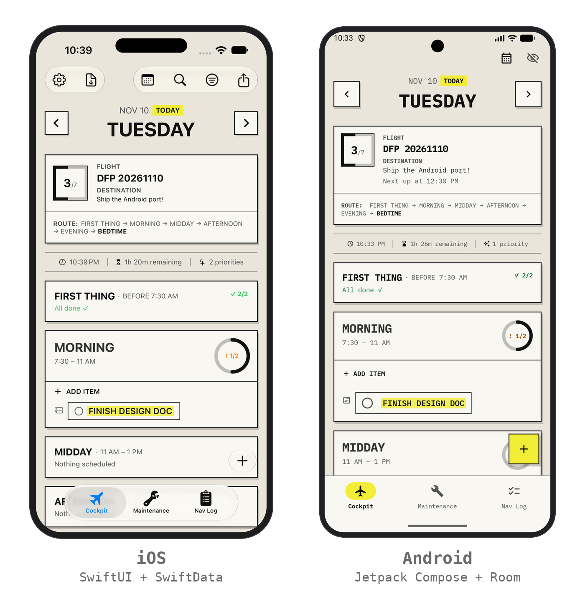
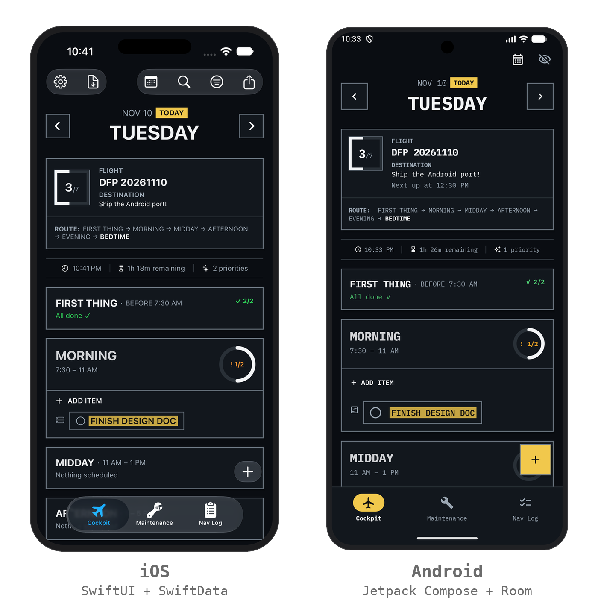

# Daily Flight Plan for Android

An early native Android port of [Daily Flight Plan](../README.md), built in Kotlin and Jetpack Compose. The iOS app stays the source of truth for look, feel, and behavior; this port keeps the same layering and the same design, and it is deliberately small.

<p align="center">
  
</p>
<p align="center">
  
</p>

<!-- Optional: a short demo GIF.
<p align="center"></p>
-->

## Status: v1, Cockpit tab only

**In:**

- Day navigation, with a Today / Tomorrow / Yesterday label, a "go to today" button, and a calendar button to jump to any day.
- The Flight Status card (progress, editable flight name and destination, next up), the briefing row (live clock, countdown to midnight, outstanding flagged count), six day-section cards, and the Open card.
- Add, edit, complete, flag, cancel, and defer-to-tomorrow, through a bottom-sheet form with time and section pickers.
- Light ("paper") and dark ("Paper Night") themes, using the same design tokens as iOS.
- Accessibility work: screen-reader semantics, measured color contrast, large-font and landscape support (details below).

**Out, on purpose:** sync, routines and templates, categories, calendar and reminders, AI summaries, drag-and-drop between sections, search and filters, and settings. The Maintenance and Nav Log tabs are "coming soon" placeholders, as on iOS.

## How it maps to the iOS app

| Concern | Android | iOS |
|---|---|---|
| Language and UI | Kotlin, Jetpack Compose | Swift, SwiftUI |
| Persistence | Room (SQLite) | SwiftData |
| Preferences | DataStore | `@AppStorage` |
| State | `ViewModel` with `StateFlow` | `@Observable` view models |
| Dependency injection | Plain constructor injection | `@Environment` |
| Unit tests | JUnit 5, with parameterized tests | Swift Testing |

The data layer depends on DAO interfaces, so repository rules are tested on the JVM with fake DAOs. The view model takes an injected clock and minute tick, so its tests never depend on the wall clock.

**Why not Kotlin Multiplatform, Flutter, or React Native?** The iOS app stays SwiftUI and SwiftData, so sharing code would have meant rewriting working iOS code. A native port also made it a fair side-by-side comparison of the two stacks.

## Tests

- **257 JVM unit tests** (no device needed), covering the model, the repository, the view model, accessibility text, and theme contrast.
- **42 instrumented tests** on an emulator: 14 Room tests that run the DAO SQL against in-memory SQLite, and 28 Compose UI tests for the Cockpit screen and the item form.
- Also checked by hand on an emulator in light and dark mode, at 2x font scale, and in landscape.

## Accessibility

- **Contrast is measured, not assumed.** The first light-mode status colors failed WCAG (orange 2.3:1, green 3.2:1, red 3.9:1), so they were reworked, and a unit test now fails if any text pair drops below 4.5:1 or any border or icon pair below 3:1, in either theme.
- **Screen readers.** Section headers read as expandable buttons with a spoken summary ("Morning, 7:30 to 11 AM, current section, 1 of 3 done, has flagged items"). Item rows announce Flagged, Completed, Canceled, and Missed, and expose Complete, Flag, Cancel, and Defer as custom actions, so nothing depends on a long-press.
- **Large text and wide screens.** The layout holds up at 2x font scale and in landscape, and content is capped and centered on tablets.

## Build and run

Open `android/` in Android Studio, or build from the terminal. From this directory:

```bash
export JAVA_HOME="/Applications/Android Studio.app/Contents/jbr/Contents/Home"
export ANDROID_HOME=$HOME/Library/Android/sdk
./gradlew :app:assembleDebug               # build
./gradlew :app:testDebugUnitTest           # JVM unit tests
./gradlew :app:connectedDebugAndroidTest   # Room and Compose UI tests; needs a running emulator
```

`local.properties` (gitignored) holds `sdk.dir` and must exist on each machine. Requires minSdk 26.

## How it was built

An AI-assisted port in six phases, using the iOS app's design docs and tests as the specification: scaffold and theme, pure logic with tests, the Room layer, the Cockpit UI, the item form, and a polish pass (launcher icon, contrast, accessibility, empty states, large fonts). The architecture and the deviations from iOS are written down in [the port plan](docs/android-port-plan.md), which also records what is deliberately left out and why.

## Known limits

- The date and time pickers are the stock Material ones (themed, but not in the app's monospaced font).
- No CI yet for the Android build, and no automated screenshot or visual regression tests.
- TalkBack behavior was reasoned from the semantics tree and verified with automated tests, not listened to on a device.
- At very large font sizes, a "NOW ·" separator can dangle at the end of a wrapped header line.
